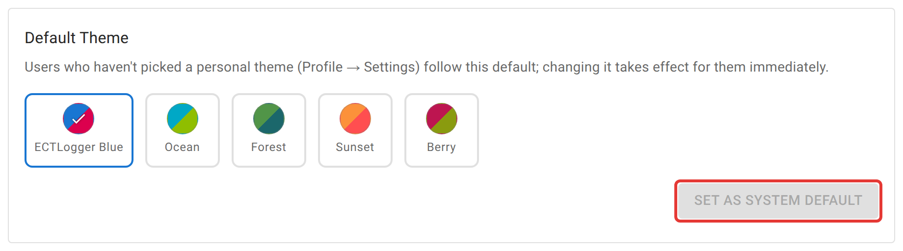
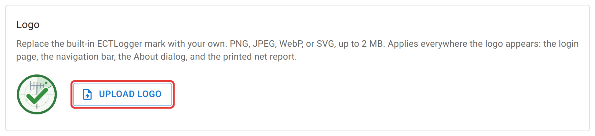

# Branding and themes

The **Branding** tab controls how the instance looks for everyone who hasn't already made their own choice, plus the logo, which applies to every visitor.

## Default theme

<figure>
  
  <figcaption>Applies only to visitors who have never picked a theme of their own in Profile → Settings.</figcaption>
</figure>

Pick a swatch and click **Set as System Default**. The button stays greyed out while the selected swatch is already the default, so it looks disabled the first time you open the tab. Anyone who has picked a personal color theme in Profile → Settings keeps that choice; this only affects people who never have.

## Default appearance

A separate light/dark toggle sets which mode a visitor gets on their first visit. Once someone picks light or dark, their browser remembers it; this setting only reaches brand-new visitors.

## Custom theme

If none of the curated swatches fit, define your own: a name, and a light and a dark color pair (primary, secondary, background, and paper) for each. Once saved, it appears as an extra swatch, labeled with the name you gave it, in this picker and in every user's Profile → Settings. **Clear** removes it and reverts everyone using it to whatever the curated default is.

## Logo

<figure>
  
  <figcaption>PNG, JPEG, WebP, or SVG, up to 2 MB.</figcaption>
</figure>

Upload a PNG, JPEG, WebP, or SVG up to 2 MB to replace the built-in ECTLogger mark. It appears in the navigation bar, on the sign-in page, and on a net's printed report. **Reset to Default** removes it and reverts to the built-in mark everywhere it appears.

## Not here

There is no setting for an instance display name beside the logo. The navigation bar shows the logo only, not a configurable site title.
