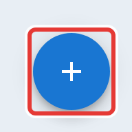

# The contact directory

The **Contacts** tab builds itself. The first time a callsign checks into any net, ECTLogger creates a contact record for it: callsign, whatever name and location were entered, and a link to the matching registered account, if there is one.

## What it's for

- **Auto-fill.** When an NCS or Logger types a callsign into a check-in that's checked in somewhere before, the name, location, and spotter number fill in automatically from here. A registered user's own account takes priority if one exists, and this record is the fallback.
- **The "who is this?" popup.** Clicking a callsign that has no linked account still shows a profile popup, sourced from this record and that callsign's own check-in history.
- **Turning a known station into an account.** If a contact has an email address on file and isn't already linked to one, **Send invite** creates an account for them and emails a magic link.

<figure>
  
  <figcaption>Most contacts appear as stations check in. Use this to add someone before their first check-in.</figcaption>
</figure>

## Editing and adding

Click any row to edit it inline: fix a misspelled name, add an email so you can invite them, or add admin-only notes (never shown to the operator). The callsign itself can't be changed once a contact exists, since it's how the record is matched. Use the **+** button to add someone by hand, ahead of their first check-in, for example to pre-load a roster of known local stations before a net.

## Deleting

A contact with no linked account can be deleted. This removes only the directory entry, not any check-in history. If that callsign checks in again, a new contact record is created. A contact already linked to a real user account can't be deleted from here; delete the account instead (see [Users and roles](/docs/admins/users-and-roles/)).

## Not here

The account this feeds into, once someone's invited, is managed from [Users and roles](/docs/admins/users-and-roles/); this tab only covers the directory entry itself.
