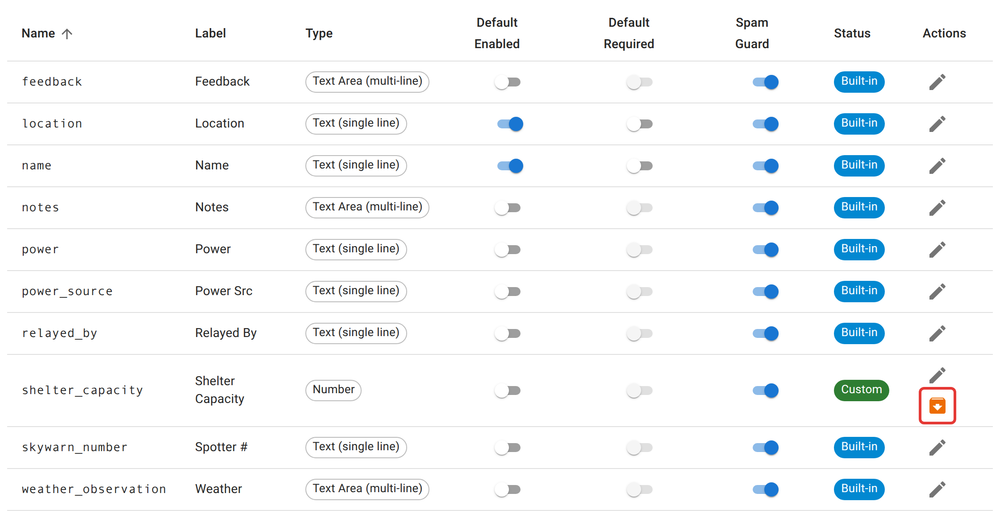

# Custom check-in fields

Every field a check-in form can ask for (Name, Location, Spotter #, Weather, Power, Notes, or anything you add yourself) is defined once, instance-wide, on the **Check-in Fields** tab. A net creator then picks which of these fields their own net actually uses, and whether each one is required. This tab defines that list.

<figure>
  
  <figcaption>The Status column is what tells the two apart. A field marked Built-in can be edited but never archived; a Custom field like Shelter Capacity can be archived instead of deleted, so past check-ins that used it stay readable.</figcaption>
</figure>

## What ships built in

Nine fields come with the instance and can never be archived: Name and Location (on by default), and Spotter #, Weather, Power Src, Power, Feedback, Notes, and Relayed By (off by default). You can still edit a built-in field's label, placeholder text, and defaults; you can't remove it from the list.

## Adding a field

1. Click the **+** button (bottom right).
2. Give it an **internal name**, using lowercase letters, numbers, and underscores only (anything else you type, including spaces and punctuation, is replaced with an underscore as you type). This can't be changed later, because values are stored under it, and it appears in exports.
3. Give it a **display label**, which operators see on the check-in form.
4. Pick a **field type**: a single line of text, a multi-line text area, a number, a dropdown (enter one option per line), or a checkbox.
5. Optionally add placeholder text, and decide whether the field should be **enabled by default** and **required by default** for a brand-new net. Both are starting points; the person creating a net can change either for that net.
6. Set a **sort order** if you want it to appear in a particular spot relative to the others. Built-in fields use 10 through 70; leave custom fields at 100 or higher so they sort after the built-ins unless you have a reason to interleave them.

## Spam Guard

Every field also carries a **Spam Guard** switch, on by default. While it's on, a check-in that submits a value looking like a URL or an email address for that field is rejected, not flagged, whether it came from the check-in form or any other client. It is meant for fields that shouldn't hold a link, such as Location and Notes. Turn it off only for a field that should hold a link or address. Left on, it keeps a station's promotional link or email address out of the check-in list and the ICS-309 log your group hands to a served agency. See [Reports, ICS-309, and exports](/docs/net-managers/reports-and-exports/) for the matching net-level setting that keeps a muted station's chat out of that same log.

## Archiving instead of deleting

There is no delete button. A field that's no longer needed gets **archived**: it disappears from the list a net creator picks from, but every past check-in that recorded a value in it keeps that value. Restoring an archived field (the same icon, now labeled Restore) brings it back as it was. Built-in fields can't be archived at all.

## Not here

Turning a specific field on or off, and deciding whether it's required, for one particular net happens when that net or schedule is created, not here. See [net managers](/docs/net-managers/). The complete list of fields and what each one means to an operator filling out a check-in is in [Check-in fields](/docs/reference/check-in-fields/).
