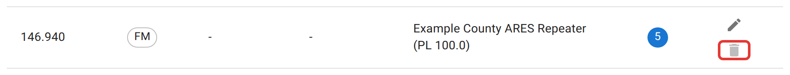

# Shared frequencies

Every frequency, repeater, or digital talkgroup a net can use comes from one shared list, maintained on the **Frequencies** tab. Net creators pick from this list instead of typing a frequency each time. Without a shared list, one net calls a repeater "146.940 ARES Repeater" and another calls it "146.94 Portland Repeater," and reports and the map disagree. Keep the list clean.

## Adding an entry

Click the **+** button (bottom right) and fill in:

- **Frequency** — e.g. "146.520 MHz." Leave this blank for a digital-only entry (DMR, D-STAR, Fusion, and similar) that has no analog frequency of its own.
- **Mode** — FM, AM, SSB, CW, GMRS, or one of the digital modes (DMR, D-STAR, YSF/Fusion, P25, NXDN, M17), plus VARA, Winlink, JS8Call, and Packet, **Data** for any other digital mode you'd run in a program such as FLDIGI (PSK31, Olivia, MT63), or Other. The net and schedule forms offer the same list.
- **Network** — for a digital mode, the reflector or network name (Brandmeister, Wires-X, REF030C).
- **Talkgroup/Room** — the talkgroup ID or room number, where the network has one.
- **Description** — free text; this shows next to the frequency everywhere else in the app, so make it recognizable ("Example County ARES Repeater (PL 100.0)" rather than just "Repeater").

An entry needs a frequency or a network, not necessarily both.

## Editing and deleting

Editing an entry updates it everywhere it's used, so you can fix a typo without touching every net that picked it. Deleting is only possible once nothing references the entry at all: no net or schedule lists it, and no station's check-in was logged on it. The **Nets Using** column shows the net count, and the delete icon stays greyed out while any of the three is in use, with a tooltip saying so. Admins can edit any entry.

Everyone else who creates nets can add to the list and pick from it. They can also edit or delete an entry **they added themselves**, from the net or schedule form, until another net or schedule uses it or a station checks in on it. Only an admin can change entries added before 2026-10-22, which have no record of who added them.

When someone can't make a change, the form offers to send it to you instead. Every admin gets an email naming the entry, what they want it changed to (or that they want it deleted), which nets and schedules use it, and their note. Its **Open the Frequencies tab** button opens this list filtered to that entry. Make the change here; there is nothing to approve in the app.

<figure>
  
  <figcaption>A frequency still in use can be edited but not deleted. The count shows how many nets use it.</figcaption>
</figure>

There's no merge tool for two entries that turn out to be the same repeater under slightly different descriptions. Clean up a near-duplicate by hand before more nets pick the wrong one.

## Not here

Choosing which frequencies a specific net actually uses, and which one is "active" during the net, happens on that net, not here; see [net managers](/docs/net-managers/) and [net control](/docs/net-control/).
