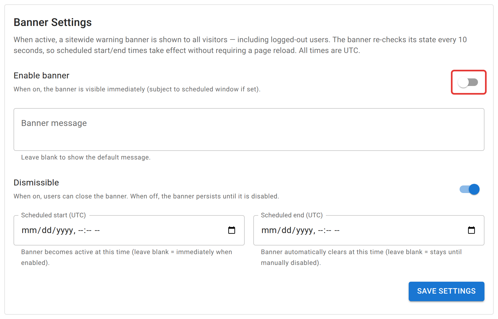

# The maintenance banner

The **Maintenance** tab puts a red bar across the top of the app for every visitor, signed in or not. Use it to warn people before planned downtime. Every browser checks for it about every 10 seconds, so turning it on reaches everyone within that time.

<figure>
  
  <figcaption>Every signed-in and signed-out visitor sees this banner within about 10 seconds of it being turned on.</figcaption>
</figure>

## Turning it on

1. Switch on **Enable banner**.
2. Optionally write a custom message. Leave it blank for a generic "scheduled maintenance in progress" notice.
3. Choose whether it's **dismissible**. On, a visitor can close it for their session; off, it stays put until you turn the banner off yourself. Use this for something they must not miss.
4. Optionally set a scheduled start and end (in UTC). Leave start blank to show it the moment you enable it; leave end blank and it stays up until you disable it by hand.
5. Click **Save Settings**.

Turning the banner off, or reaching a scheduled end time, clears it for everyone automatically, including anyone who had already dismissed it; re-enabling it later shows it again.

## How this differs from the update notice

A second, yellow banner can appear independently of anything on this tab: when the frontend gets redeployed, any browser tab still running the old version shows a "new version available" notice with a **Reload** button. You don't configure that one. It is checked every five minutes and doesn't block anything, so it is yellow instead of red. Red means something is about to break; yellow means reload when convenient.

## When the banner can't help

This banner is a feature of the running app. If the backend itself is down, or the database is unreachable, nothing on this tab can reach anyone, because the app that would show it isn't running. That situation needs the server-side maintenance page instead, which the web server holds up on its own without the app running at all. The procedure is under "Maintenance Mode" in [Production deployment](/docs/PRODUCTION-DEPLOYMENT/), and it's a self-hosting task rather than something an admin can do from inside the app.
