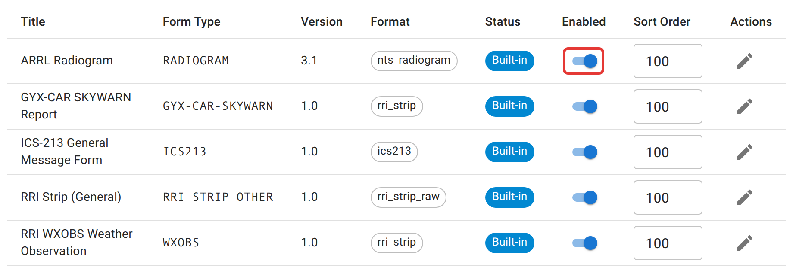

# Traffic handling settings

The **Traffic** tab decides which formal message formats an operator is offered when they file a piece of traffic: ARRL radiograms, ICS-213 general messages, weather-observation strips, and anything else the instance has defined. It also sets the order they're listed in and the wording of each field's label and help text. It does not change what any of those formats *are* — see [the glossary](/docs/reference/glossary/) if a format name here is unfamiliar.

<figure>
  
  <figcaption>Turning a format off removes it from the type picker. Past messages filed in that format are unaffected.</figcaption>
</figure>

## Enabling, ordering, and relabeling

Each row is one message format. From here you can:

- **Enable or disable** it with the switch, which controls whether it shows in the type picker. Nothing already filed in that format is touched.
- **Reorder** it by editing the sort order number and clicking away; lower numbers appear first.
- **Edit field labels and help text** with the pencil icon — the label an operator sees for each field, and the description underneath it.

## What can't be changed here

The instance ships with built-in formats, including the ARRL Radiogram and the ICS-213 General Message. Their field structure is fixed to follow the ARRL/NTS format, so a receiving station elsewhere recognizes it. You can relabel a built-in field's display text, but you can't add, remove, or retype the fields themselves.

## Defining a new strip type

A new format isn't created from this tab, and it isn't an admin job. An [RRI strip](/docs/reference/glossary/) is a short slash-delimited message with a fixed set of fields, and any operator defines a new one by pasting a real example of it while filing traffic and labelling the fields they see. After that it behaves like a built-in: it appears in this table, and you can enable, disable, reorder, and relabel it here. See [net control](/docs/net-control/) for where that actually happens.

A type can't be defined twice; a second attempt at an existing type is refused.

## Not here

Filing, promoting, and closing out an actual piece of traffic is covered in [net control](/docs/net-control/), not here — this tab only controls which formats exist and what they're labeled.
