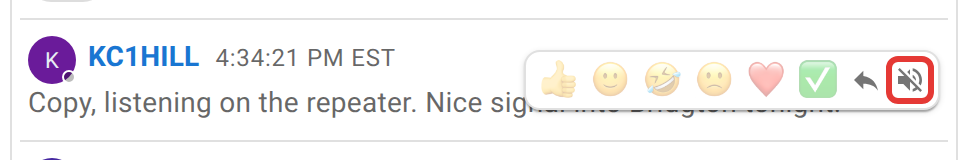
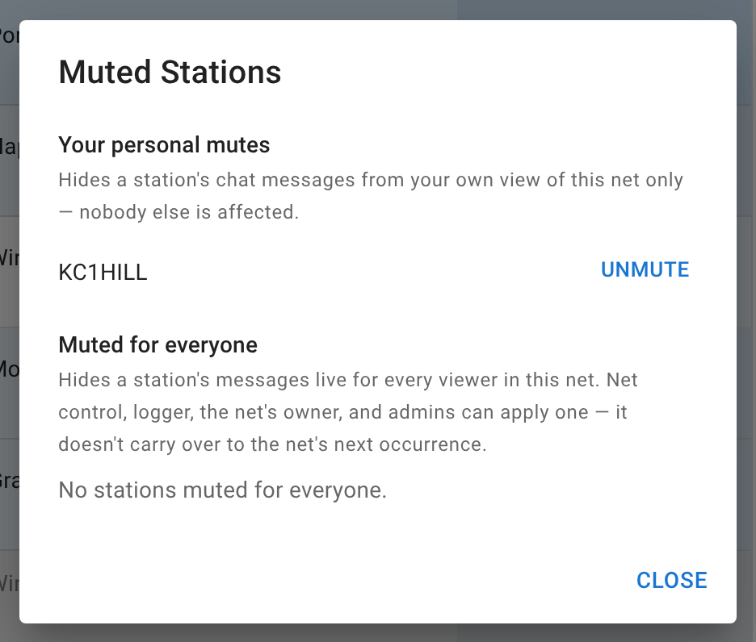

# Chat moderation

Chat has two mute controls behind the same icon. One is a personal filter anybody can use; the other is a moderation action reserved for staff. One changes your own screen, the other changes everybody's. Neither tells the muted station.

## Muting a station for yourself

Anyone can do this, on any message that isn't their own. Hover the message and click the mute icon that appears in its hover toolbar.

<figure>
  
  <figcaption>A plain click mutes a station for you only. As Logger or NCS, shift-click the same icon to mute them for everyone in this net's chat.</figcaption>
</figure>

A plain click hides that station's messages from your own view of this net's chat, for the rest of the net. The messages still arrive; they're just not shown to you. Nobody else's view changes, the muted station is never told, and the net's exported chat log is unaffected.

Each mute of either kind is counted. When several different people have muted the same station, the instance's admins get an email with the count and the nets, but a personal mute never says who did it. This is how a station disrupting nets across the instance gets noticed by someone who can act.

## Muting a station for everyone

This is a staff action: the net's active NCS and Logger, plus the net's manager and any admin. **Shift-click** the same mute icon instead of a plain click, and that station's chat messages stop reaching every other viewer's browser for the rest of this net.

How far it reaches:

- It's enforced on the server when a message is broadcast: a net-wide-muted station's messages (and any images they send) are never sent to other viewers' browsers.
- It's a **shadow mute**. The muted station is never notified and sees their own messages appear normally in their own chat window, with no sign inside the app that anyone else has stopped seeing them.
- It doesn't touch the record. Reloading the chat history and every export of the net's chat log still include every message from every station; a net-wide mute only affects the live broadcast.
- It doesn't persist past this net. There's no standing "banned from chat" list.
- Any active NCS or Logger can lift a mute someone else applied.

## Managing mutes

The banner above the chat window shows a running count of stations muted in this net's chat (both kinds combined) and a **Manage** link that opens your own personal mutes and, if you're NCS or Logger, a separate section for stations muted net-wide by staff.

<figure>
  
  <figcaption>Personal mutes and net-wide mutes are managed in the same dialog but never mix with each other.</figcaption>
</figure>

Unmuting from either list is immediate. For a net-wide mute, every open tab updates without a reload.

## Next

[Handling traffic](/docs/net-control/handling-traffic/) and [Authenticated nets](/docs/net-control/authenticated-nets/) cover the other two things NCS and Logger can do that a Standard participant can't.
