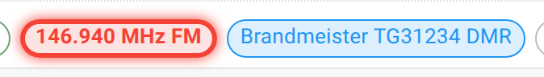

# Frequencies and multiple net controls

A net doesn't have to be one frequency and one Net Control Station. A multi-band ARES or SKYWARN exercise runs several repeaters or talkgroups under a single net, each with its own desk, all logging into the same check-in list. This page covers working one frequency chip, and what it looks like when more than one NCS is active on the same net at once.

## Frequency chips

If a net has more than one working frequency, each one shows as a chip in the net's header row, next to the status and duration chips. What clicking a chip does depends on who you are:

- **If you're an active NCS**, clicking a chip **claims it as yours**. It becomes the frequency you're monitoring, shown with a star and your own color, and it's added to your own check-in's available frequencies. A different NCS on the same net claims a different chip the same way; two NCS can claim two different frequencies at once. Click your claimed chip again to release it, for example when you're coordinating every band rather than working one. With no claim, a check-in you log gets the frequency you pick for it, or the net's active frequency if you don't pick one.
- **If you're Logger or the net's manager** (but not an active NCS), clicking a chip instead sets it as the net's single **active frequency**, the one highlighted blue in the check-in list for whoever's on it. Click the active chip again to clear it.
- **If you're Relay or a Standard participant**, a plain click on a chip does nothing. Ctrl+click still works for you, covered next.
- **Ctrl+click** (or Cmd+click on a Mac) filters the check-in list to that frequency, whoever you are. It never changes anyone's claim or the net's active frequency.
- On a closed or archived net, chips are view-only, and clicking one does nothing.

<figure>
  
  <figcaption>Those colored outlines are the app's own, not a callout on this page. Each active NCS claims a different chip, and the color follows the operator, so the same red marks W1PINE's row in the check-in list.</figcaption>
</figure>

Filtering the check-in list to one frequency never hides an active NCS's own row, whichever frequency they've claimed.

## More than one NCS at once

A net can have several active NCS at once. This isn't an error state: a multi-desk exercise with each NCS on a different frequency is what frequency claiming is for. The first NCS assigned gets the plain NCS crown, and every other active NCS gets a second, smaller **2nd NCS** crown next to their name.

"2nd NCS" is a label in the legend, not a separate role you assign. Every NCS on the net holds the same role; the label marks that more than one is active. [Station statuses](/docs/reference/station-statuses/) covers the legend in full, including the other things it mixes in alongside roles and statuses.

## Becoming a second NCS

There's nothing special to do. Any operator eligible to become NCS on this net can check themselves in as NCS the normal way, whether or not someone else already holds the role. [Roles and stepping away](/docs/net-control/roles-and-stepping-away/) covers who's eligible and how, and [Roles and permissions](/docs/reference/roles-and-permissions/) has the complete rules.

## Next

[Roles and stepping away](/docs/net-control/roles-and-stepping-away/) covers taking, sharing, and handing off NCS itself, and [Handling traffic](/docs/net-control/handling-traffic/) covers formal message traffic, which works the same way on any number of frequencies or desks.
