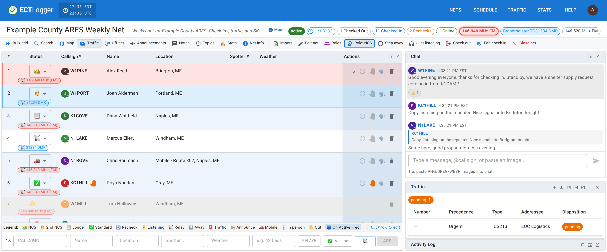
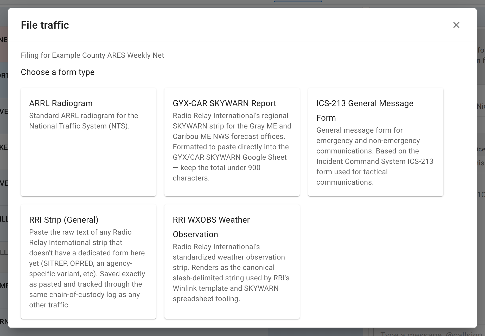

# Handling traffic

Some nets carry formal message traffic (ARRL radiograms, ICS-213 general messages, or a SKYWARN weather strip) alongside ordinary check-in logging. If a net has Assisted Traffic Handling turned on, NCS, Logger, and the net's manager get a Traffic panel on the net view for filing and tracking it.

## Who sees it

The toolbar's **Traffic** button only appears when a net has traffic handling enabled and you're the net's manager, an admin, or hold an active NCS or Logger role on it. A Standard participant doesn't see this button, even on a traffic-enabled net. Their own way to file traffic is the **Traffic** item in the top navigation bar instead, covered on the operators path.

Stepping down to Standard from **Role: NCS** takes the panel away with it, like every other staff control. The figures on this page are from the net manager's seat; the panel looks the same from any of them.

## The traffic panel

Clicking **Traffic** opens a panel beside the check-in list: a summary strip showing how many pieces of traffic are in each state (draft, pending, relayed, delivered, cancelled, and how many are outstanding), and a short list of recent forms filed on this net.

<figure>
  
  <figcaption>The Traffic panel opens beside the check-in list; you file and view traffic without leaving the net view.</figcaption>
</figure>

Like Chat and the Activity Log, this panel can be detached into a floating overlay or popped out into its own window; see [Multiple monitors and wide screens](/docs/net-control/multiple-monitors/). Clicking any row opens that form's full detail, with a back arrow to return to the list.

## Filing traffic

The **+** in the panel's header opens the filing dialog, offering the message types this net has enabled.

<figure>
  
  <figcaption>Only the form types this net turned on appear here; the standalone Traffic section can always reach the rest.</figcaption>
</figure>

Fill in the form for whichever type you picked and submit. It appears in the panel immediately, and every other viewer's Traffic panel and the traffic inbox badge update live.

## Logging the chain of custody

Open a piece of traffic's detail view and you'll find its chain of custody, an append-only log of everything that has happened to that message: originated, received, relayed, delivered, serviced (reported back to the originator), or cancelled. **Log Handoff** adds the next hop: pick the action, optionally the method (voice net, phone, email, in person, and so on), who handled it, who it was handed to, and a note if it needs one.

About this log:

- It's append-only. There's no edit button. If a hop was logged wrong, log a corrected entry afterward. Only an admin can remove an entry, and only the most recent one, for a mis-click.
- "Handled by" defaults to your own callsign. It's editable; change it when you're logging a hop someone else told you about over the net.

## Your inbox

Any piece of traffic you hold (something you originated or received that hasn't moved on yet) shows up in your traffic inbox, with a count badge in the top navigation bar. The inbox is the same whichever net the traffic came from, so check it after a net you were running has closed.

## When something sits too long

While a piece of traffic is still pending, ECTLogger emails whoever is holding it, escalating as it ages, and how fast that happens is set by the message's own precedence: an Emergency message is chased after an hour, a Priority one after four, a Routine or Welfare one after a day. Each level gets three reminders, spaced further apart each time. A message carrying an **HXB** handling instruction, which names its own expiry in hours, follows that deadline instead: one reminder at the halfway mark, and a final notice when the time is up. [Emails we send](/docs/reference/emails/) lists the exact intervals.

The clock starts when the message reaches you, and the reminders stop the moment you log the next hop. There is nothing to mark as done: relaying, delivering, or cancelling the message ends them, and until then it is still yours. Drill traffic is chased like the real thing; [demo traffic](/docs/reference/glossary/) never is.

## Exporting

The panel's export button offers two outputs: **Text**, one line per report, good for pasting into a spreadsheet or a Winlink template; and **PDF**, every report rendered as its form (a radiogram pad, an ICS-213, or a strip layout) for printing or handing off on paper.

**Blank ICS-213 pad (PDF)** prints blank ICS-213s for teams to write on in the field, with the incident name filled in. Choose how many copies, up to 50.

### Drill traffic is marked as an exercise

ARES exercise plans require every formal message to say it is an exercise at its start and end. Any form marked as drill traffic prints with **THIS IS AN EXERCISE** at the top and bottom, and its text export begins and ends with the same line. For a blank pad, tick **Mark as an exercise**. Prepared messages sent from a [drill plan](/docs/net-managers/drill-plans/) are filed as drill traffic automatically.

## Next

[Closing the net](/docs/net-control/closing-the-net/) covers what happens to a net's traffic once the net itself closes, and [Authenticated nets](/docs/net-control/authenticated-nets/) covers the other identity-adjacent staff tool on the net view.
