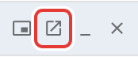
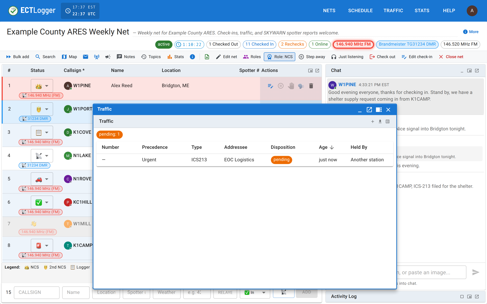
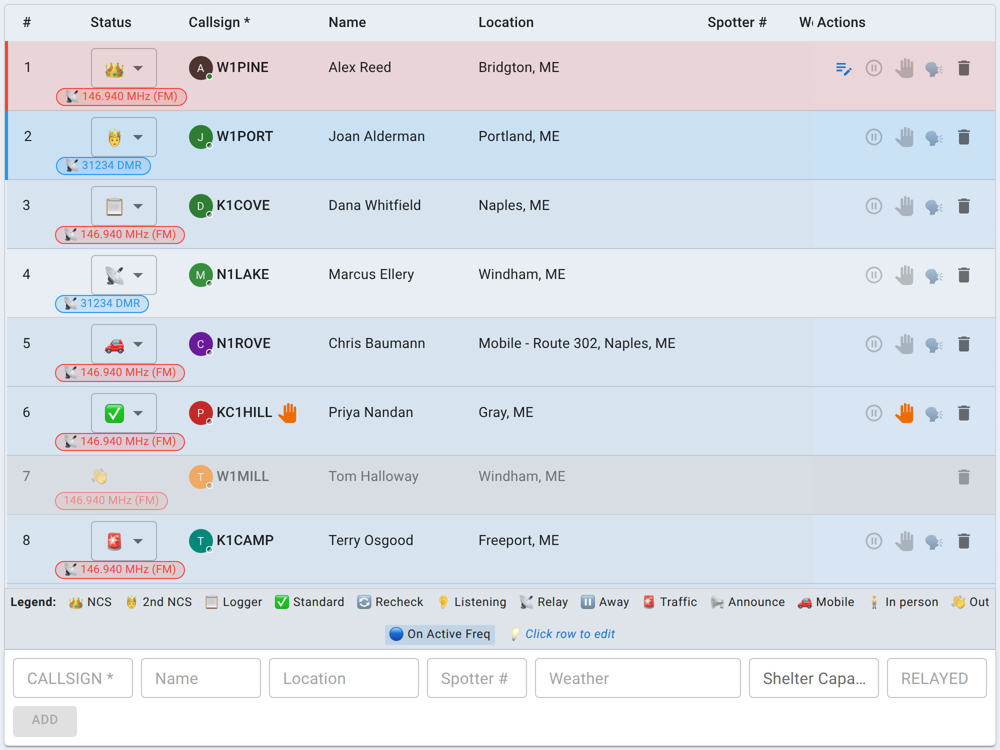
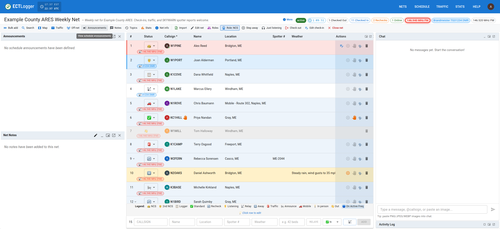

# Multiple monitors and wide screens

A busy net is cramped on a single laptop screen, so the net view can spread across more room. Chat, the Activity Log, the check-in list, Map, Coverage, Traffic, and the net's Script, Notes, and Announcements can each be moved independently, with the same three moves.

## The three moves

Every docked panel carries the same small row of controls in its header:

<figure>
  
  <figcaption>Every docked panel (Chat, Activity Log, Map, Coverage, Traffic) carries this same row.</figcaption>
</figure>

- **Detach** turns a docked panel into a draggable, resizable floating overlay that stays on top of the rest of the page.
- **Open in new window** (the pop-out icon) goes further: it opens that panel in a separate browser window with its own connection to the net. Drag that window onto a second monitor and it keeps working there. It doesn't share state with the tab it came from; it stays in sync with the net like any other connected viewer.
- **Maximize**, on the Map and Coverage, fills the screen with the panel. **Restore** puts it back where it was.
- **Minimize** collapses a panel down to its header bar without closing it, and **Close** removes it from the layout entirely (for panels that can be shut, like Coverage and Traffic; Chat and the Activity Log are always present, so their only "put it away" move is detaching or minimizing).

<figure>
  
  <figcaption>Detach keeps a panel in the same browser tab but lets you drag and resize it anywhere over the page.</figcaption>
</figure>

<figure>
  
  <figcaption>A popped-out pane is a second window with its own connection to the net; move it to another monitor and it keeps working.</figcaption>
</figure>

The Map and Coverage open floating, since a map or a coverage grid needs more room than the column beside Chat has. Click **Dock to layout** on either to put it in the column instead.

Every layout choice you make (what's docked, what's detached, what's popped out, and each panel's minimized state) is remembered per browser, so your desk looks the same the next time you open a net on the same machine.

## On an ultrawide monitor

On a wide enough screen, a second column on the left side of the page holds the net's Script, Notes, and the schedule's Announcements, beside the check-in list and Chat on the right. Below that width, those three are floating panels you open when you need them. Their content is the same either way.

<figure>
  
  <figcaption>At ultrawide widths, Script, Notes, and Announcements get a column of their own instead of floating over the list.</figcaption>
</figure>

## Next

[Closing the net](/docs/net-control/closing-the-net/) is next once your desk is set up.
