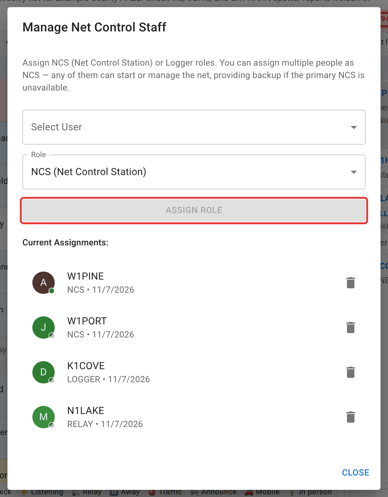
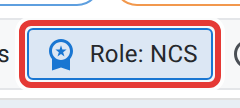

# Roles and stepping away

Net Control, Logger, and Relay are all per-net roles, held for one net and gone once it closes. This page covers taking one, handing it to someone else, stepping down, and what happens to the net while nobody's actively holding NCS.

## Taking a role by checking yourself in

If you're on the schedule's net staff or its NCS rotation for the schedule this net came from, you don't need anyone to hand you a role: checking yourself in offers a **Check In as NCS** or **Check In as Logger** choice right alongside the plain participant option, and it works even on a week you weren't specifically scheduled. This is opt-in. Checking in normally never makes you NCS or Logger, and a check-in someone else enters for you (over the air, by voice) never grants a role either.

This doesn't depend on whether the net already has an active NCS. Several eligible staff can each claim NCS for their own desk, as in a large exercise; [Frequencies and multiple net controls](/docs/net-control/frequencies-and-multi-ncs/) shows what that looks like on screen. The full eligibility rules (who counts as net staff, what a rotation member can do, and the difference between that and a schedule's co-manager tier) are in [Roles and permissions](/docs/reference/roles-and-permissions/); this page covers what happens once you act on it.

If you aren't on the net staff or rotation of the net's schedule, self-grant isn't available, so someone already running the net has to assign you the role directly, covered next.

## Assigning a role to someone else

Open **Roles** on the toolbar (see [The net control desk](/docs/net-control/the-net-control-desk/)). This opens **Manage Net Control Staff**: pick a user, pick NCS, Logger, or Relay Station, and click **Assign Role**. Every current assignment is listed below with its own remove control.

<figure>
  
  <figcaption>Assigning a role here works alongside self check-in; either path can put someone in NCS or Logger.</figcaption>
</figure>

This dialog is available to the net's manager, an admin, or (on a templated net) staff who already hold an active NCS or Logger role on this specific occurrence themselves. Being on the staff list or rotation isn't enough without one of those two roles here, and the **Roles** button doesn't appear unless you meet that bar. If a net has no NCS assigned at all, the net's manager or an admin can also use **Claim NCS**, a recovery button for an orphaned net, not for everyday handoffs.

## Stepping down, and stepping away

These are different things.

**Stepping down** (the **Role: NCS** / **Role: Standard** toggle on the toolbar) toggles whether your existing NCS role is active. Step down and you lose NCS access to this net. You keep the role and can step back up later. If you're the *only* active NCS on a net that's currently active, this toggle is blocked; assign or wait for another NCS first.

Choosing **Check In as Participant** when you check yourself in steps you down the same way, from NCS or Logger, with the same rule for the only active NCS.

<figure>
  
  <figcaption>This toggles your own active/standard status on the NCS role you already hold. It never grants NCS.</figcaption>
</figure>

**Stepping away** (the **Step away** button) is a status change on your own check-in. It marks you Away, the same as anyone else's Away status. Unlike stepping down, this is allowed even if you're the only active NCS, but then it asks you to confirm first: "No one else is acting as NCS on this net. Stepping away leaves it without anyone actively running it until you return or hand the NCS role to someone else." Confirm and it goes ahead; it's a warning, not a lock.

## The paused-net banner

If none of the net's active NCS are present (checked in, and not Away or Checked out), the net is considered **paused**. Every viewer sees a blue border around the whole browser window and a banner reading "Net Control has stepped away — this net has been paused until they return."

Notes:

- It only happens when the net **has** an assigned NCS who isn't currently present. A net running with no NCS assigned at all isn't paused. That's the normal "open net, nobody has claimed control yet" state, not an error.
- It clears when any active NCS is present again. There's nothing to dismiss.
- Check-ins, chat, and everything else keep working. Pausing is a signal for anyone watching, not a lockout. The only thing it changes is the net's running time: paused minutes are left out of the duration timer and the net's statistics.

## Next

[Chat moderation](/docs/net-control/chat-moderation/) and [handling traffic](/docs/net-control/handling-traffic/) cover the other two responsibilities that come with holding NCS or Logger.
