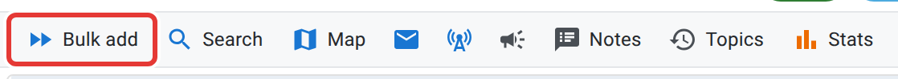
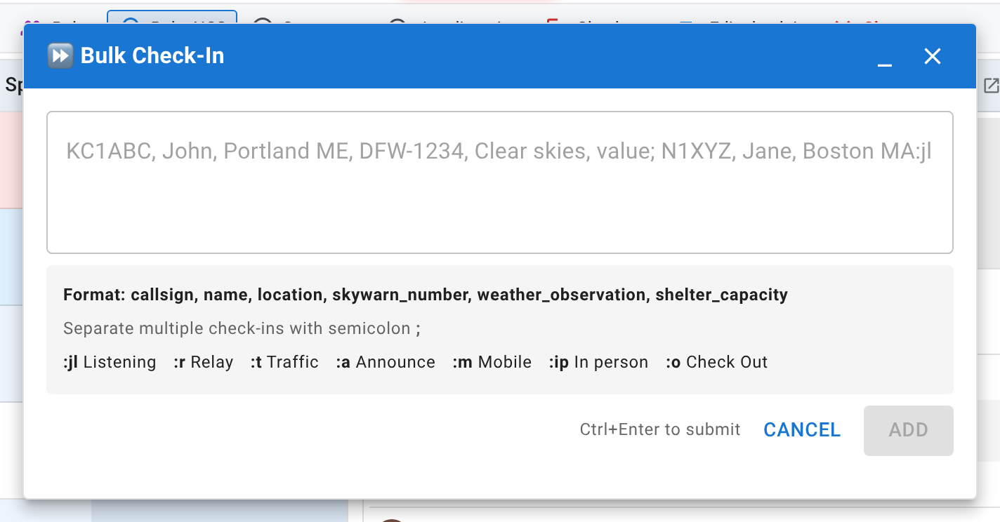

# Speed entry

When check-ins are coming in faster than you can click through a form for each one, this is the tool for it. Long-time operators tend to call this "speed entry," but the button on the screen reads **Bulk add**, with the tooltip "Bulk add multiple check-ins". That's the label to look for.

<figure>
  
  <figcaption>The Bulk add button, leftmost in the net control toolbar.</figcaption>
</figure>

**Bulk add** is visible to NCS and Logger once the net is in lobby or active and has at least one check-in already on it. Relay does not get this button and logs check-ins the ordinary way instead.

## Opening it

Click **Bulk add**. A window opens with a single multi-line text box and, underneath it, a "Format:" line showing which fields this net expects and in what order, the semicolon separator, and the status shortcuts. The line depends on which check-in fields the net's manager turned on, so read it instead of assuming it matches the last net you ran.

It's a floating window: drag it by its title bar off the check-in list, and it stays where you put it.

<figure>
  
  <figcaption>The box accepts one check-in per line-segment, separated by semicolons; Speed entry syntax has the exact grammar.</figcaption>
</figure>

## Using it during a net

Type each check-in's fields separated by commas, and separate check-ins from each other with a semicolon: one caller, comma-separated fields, next caller after a semicolon. A single check-in works the same way. The exact field order, the status shortcuts (`:jl` for Listening, `:r` for Relay, and so on), and a full worked example are in [Speed entry syntax](/docs/reference/speed-entry-syntax/). This page is about the workflow; that one is the grammar.

While you're typing:

- **Ctrl+Enter** submits.
- Each entry in the line is submitted on its own, so one bad callsign doesn't hold up the rest of the batch. The result tells you how many succeeded, how many failed, and what went wrong with the failures.
- Callsigns are uppercased and format-checked automatically.

## What everyone else sees while you're typing

While the box is open, every other viewer of the net, participants included, sees a brief notice below the check-in table warning that check-ins may arrive in bursts. It clears a few seconds after you close the box or stop typing.

## Cleaning up afterward

A batch-added row is an ordinary check-in afterward. If you mistype a callsign in the rush, fix it the same way you'd fix any other row: click it to edit it in place, covered in [Logging check-ins](/docs/net-control/logging-check-ins/). If you accidentally add a duplicate, delete the extra row rather than leaving it; a recheck (someone calling in again) is different from a typo that repeats a callsign, and only the recheck should stay.

## Next

[Logging check-ins](/docs/net-control/logging-check-ins/) covers the single-station path this exists alongside, and [Frequencies and multiple net controls](/docs/net-control/frequencies-and-multi-ncs/) covers a net running more than one frequency at once.
