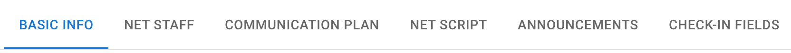
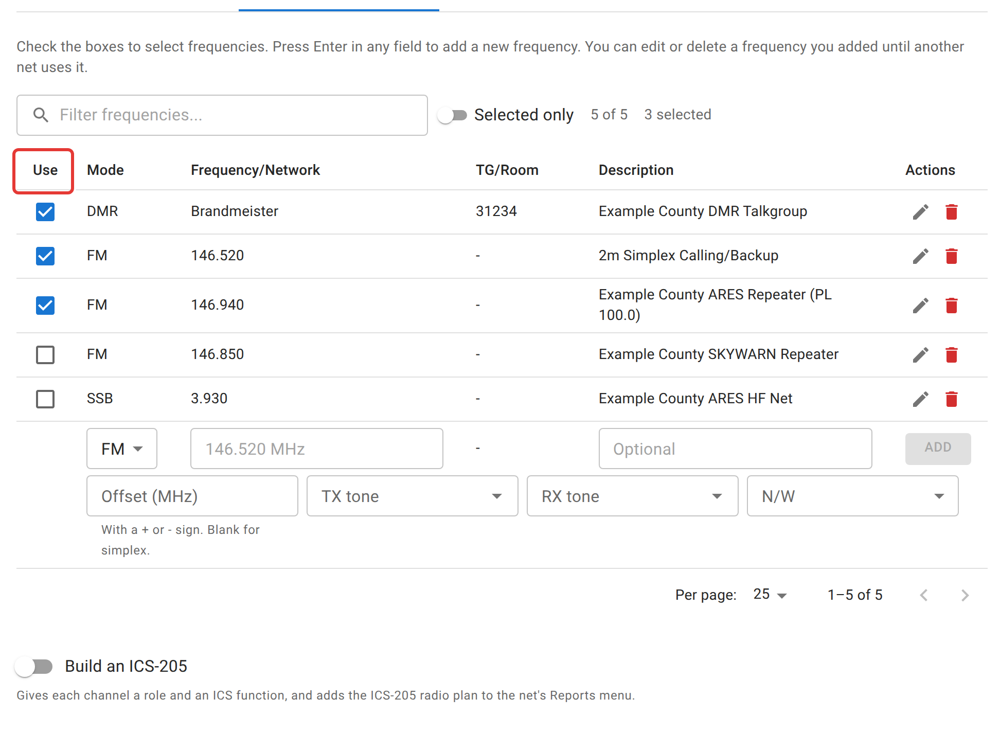

# Creating a net

A net is one session: one night, one log, one set of check-ins. If you want the same net to come back every week, don't fill this form out from scratch each time. Build it once as a [schedule](/docs/net-managers/recurring-schedules/) instead, and let ECTLogger create the net for you.

## Starting a net

Starting a net and editing one go through two different forms. The dashboard's **+** button (tooltip **Create new net**) walks you through the same tabs as [setting up a schedule](/docs/net-managers/recurring-schedules/), pre-set to a one-time occurrence; save it and ECTLogger creates the net and takes you straight there. The **Create** button on an existing schedule's card skips the form, creating the next occurrence on the spot and opening its net view. Either way, this page covers what you land on afterward: **Edit Net**, reachable from any net's own toolbar once it exists.

A brand-new account may not be able to do either one right away. See [a brand-new account may have to wait](/docs/net-managers/recurring-schedules/#a-brand-new-account-may-have-to-wait) for the age, participation, and daily-limit rules your instance may enforce.

## The seven tabs

<figure>
  
  <figcaption>Every net, one-time or from a recurring schedule, is edited through these seven tabs.</figcaption>
</figure>

Only **Net Name** and **at least one frequency** are required. Everything else can be filled in later from **Edit Net**.

### Basic info

Name, description, an optional info URL and audio stream URL, and a scheduled start time. Setting a start time turns on the countdown timer participants see before the net goes live, and it's also what [auto-open lobby](/docs/net-managers/lobby-and-auto-close/) counts backward from.

Below that the switches come in four groups. Most are off by default; a net from a schedule starts with the schedule's settings. **General Net Features** is always shown. The other three fold away when nothing in them is on: a folded group shows how many options it holds and a small label for each one that is on. Click **Show options** to open one. A group with something on starts open, both when you create the net and when you edit it.

- **General Net Features**: prioritize mobile stations in the check-in list, [keep chat open](/docs/operators/chat-and-polls/#chat-after-the-net-closes) for 15 to 60 minutes after closing, allow or block **self check-in** (turn this off if you want every check-in to come in over the air and be logged by staff instead), **Participants only** (below), the [auto-lobby and auto-close](/docs/net-managers/lobby-and-auto-close/) settings, and **Enable Assisted Traffic Handling**. Traffic handling adds a Traffic panel for net control, and **Traffic this net takes** narrows the form types staff are offered; see the traffic pages in [Net control](/docs/net-control/) for what staff do with it.
- **Participants only** marks a net that is for the stations taking part in an event or incident, such as a drill's deployed teams, and not for everyone listening. It doesn't turn off self check-in, so you can leave that open when you won't know until the day who volunteers. The net gets a red **Participants only** label, beside its status in the net and under its name on its card in the lists of nets, and the check-in form tells stations that the net is for those taking part and asks anyone else to listen without checking in. If someone checks in anyway, net control can [remove and block](/docs/net-control/logging-check-ins/#removing-and-blocking-a-station) them.
- **Community Net Features**: **Topic of the Week** asks participants a free-text question at check-in; **Participant Poll** asks a short question with autocompleted answers so the results stay countable. Turning either on adds a locked, always-enabled row for it on the Check-In Fields tab.
- **ARES & EmComm Features**: the ICS-309 Communications Log format for the closing email, station-to-station coverage logging ("can hear" reports, with a second switch, **Allow stations to self-report**, that decides whether stations can record their own or only net control can; see [Station coverage](/docs/net-control/station-coverage/)), the net's [Sites](/docs/net-managers/sites/), and **Authenticated Net**, which lets Net Control or the Logger compare a checked-in station's live authenticator code against the one ECTLogger computes for their account. A station with no two-factor authentication set up shows as unverified; the check-in goes through. Once the net exists, its [drill plan](/docs/net-managers/drill-plans/) opens from here too.
- **SKYWARN Features**: the RRI / weather strip fields for a spotter net. Pick the strip type staff collect, or paste the originating strip so staff get its fields in the same order. Strips are filed as traffic, so choosing or pasting one turns on **Enable Assisted Traffic Handling** under General Net Features, and if you've narrowed **Traffic this net takes**, adds the strip's form type to that list.

Once the net exists, a **Net Logo** uploader appears here too. It's shown on net cards, beside the net name on the check-in page, and at the top of the net's report, and accepts PNG, JPEG, or WebP. Whichever format you upload is what gets stored, so a transparent PNG logo stays transparent.

### Using a logo that's already here

If your team's logo is already on another net or schedule, you don't need the original file. Click **Choose Existing** under the logo to see every logo in use on this site, each labelled with the schedules and nets that use it. Pick one and click **Use Logo**. A closed net can get a logo this way too.

A net made from a schedule starts with the schedule's logo, and keeps it. If the schedule's logo is replaced or removed later, nets that already ran keep the logo they had, so an old report doesn't change.

### Updating your other nets

When you replace a logo, by uploading a new one or choosing an existing one, ECTLogger checks for your other nets and schedules that still show the old logo. If there are any, it lists them, all ticked. Untick any you want to leave alone, such as a past net whose report should stay as it was, then click **Update**. Click **Leave them** to change only this one. The list only includes nets and schedules you can edit.

### Net staff

A net's staff come from its schedule, so this tab lists the schedule's staff and who is NCS for this net, but doesn't change either. Schedule staff hold no role on the net until one of them checks in as NCS or Logger, so an empty NCS list before the net starts is normal. Click **Open the schedule's staff** to add or remove staff, change the rotation, or swap this night to someone else. The schedule's Staff dialog opens on top of this page; close it and you're back where you were, with anything you changed on the other tabs still there. See [Net staff and the NCS rotation](/docs/net-managers/net-staff-and-rotation/).

### Communication plan

<figure>
  
  <figcaption>Check a frequency's box to make it available on this net. Add a new one from the blank row at the bottom, with a repeater's offset and tones on the line under it. Build an ICS-205 turns the list into a radio plan.</figcaption>
</figure>

Every net needs at least one frequency or digital talkgroup. Check the boxes in the **Use** column to attach existing ones, or fill in the blank row at the bottom to add a new repeater, simplex frequency, DMR/D-STAR/YSF/P25 network, or GMRS channel and it's added to the shared list for next time. Pressing Enter in any field of that row saves it, same as clicking Add. Turn on **Selected only**, beside the filter box, to see just the frequencies this net uses.

The list shows 25 frequencies a page; change **Per page** under the table to 50 or All. The frequencies this net already uses when you open the tab are listed first. Click a column heading to sort the whole list by that column. The filter box and **Selected only** search every page, and the counts beside them show how many frequencies match and how many are selected. Ticked boxes stay ticked when you change pages, and the blank row for adding a frequency is at the bottom of every page.
 The list is shared by every net on the site. You can fix or delete an entry you added yourself with the pencil and trash icons on its row, until another net or schedule uses it or a station checks in on it. You can also edit, but not delete, any entry this net or schedule uses when only your own nets and schedules use it, including the schedule's past nets. For any other entry, the same icons let you send the change to the admins, who make it in [Shared frequencies](/docs/admins/frequencies/).

A repeater that shares its frequency with one already in the list can be added as its own entry. Give it a description that tells the two apart, such as its callsign and town.

#### Repeater offset and tones

Adding or editing a frequency opens a second line under its row with **Offset (MHz)**, **TX tone**, **RX tone**, and **N/W**. Type the offset with its sign, such as -0.600 or +5.000, and leave it blank for simplex. Pick each tone from its list: a CTCSS tone such as 100.0, a DCS code such as D023, or for P25 a network access code such as NAC 293. **N/W** is narrow or wide FM. A DMR, D-STAR or YSF talkgroup has none of these fields, and P25 has only the tones. On the net, a frequency's chips show its offset and tone after the frequency, for example "146.940 MHz FM −0.600 PL 100.0".

#### Build an ICS-205

Turn on **Build an ICS-205**, below the frequency list, to make the net's ICS-205 Incident Radio Communications Plan: the Incident Command System (ICS) form that lists each radio channel and what it is for. Two things appear under the switch.

- **ICS-205 channel plan** lists the selected frequencies in the order they print, as channels 1, 2, 3. Move a channel with its up and down arrows. For each one, pick a **Role** (Primary, Alternate, Contingency, or Emergency, the PACE order, or None) and a **Function** (Command, Tactical, Ground-to-Air, Air-to-Air, Support, or Dispatch; a new channel starts as Tactical), and fill in **Assignment**, such as Net control or Shelters, and **Remarks**. The role prints at the start of the channel's remarks. Ticking a frequency's box adds it to the end of the plan, and unticking it takes it off.
- **Special instructions** is block 5 of the form, for things like cross-band or linked repeaters, or what stations do when the primary channel fails.

An FM channel that looks like a repeater but has no offset or tone shows a reminder to add them with the pencil on its row. The plan is saved with the net, and a schedule's plan is copied to each net the schedule creates. On a net you're editing, **Open ICS-205** opens the net's form, as last saved, in a new tab. For the form itself, see [The ICS-205 radio plan](/docs/net-managers/reports-and-exports/#the-ics-205-radio-plan).

### Net script and announcements

The **Net Script** tab is the formatted text Net Control reads from during the net. The **Announcements** tab holds two separate texts, each labelled:

- **Announcements (every net from** *your schedule***)**: the schedule's standing announcements. Changes here are saved to the schedule when you save the net, so every net from it and the Schedule page show the same text. If you don't manage the schedule, you see them but can't change them.
- **Notes for this net only**: anything specific to tonight. Everyone watching the net sees them under **Notes**.

Both are covered in full in [Scripts, notes, and announcements](/docs/net-managers/scripts-and-announcements/).

### Check-in fields

Callsign is the only field every net always requires. Everything else (Name, Location, Spotter #, Weather Observation, Power Src, Power, Feedback, Notes, Relayed By, and any custom fields your instance's administrator has defined) is switched on or off and marked required or optional independently, per net. See [Check-in fields](/docs/reference/check-in-fields/) for the complete list. Turn on **Relayed By** for a net that regularly uses relay stations; on any other net it still appears by itself once a station is set to Relay. If **Topic of the Week** or **Participant Poll** is on, its response field appears here too, locked on.

### Reports

The **Reports** tab sets what goes into the closing email, the log ECTLogger emails when the net closes (see [who gets it](/docs/net-managers/reports-and-exports/#who-automatically-gets-the-closing-log-by-email)). **Net summary and check-in log** is always included. Below it is a switch for each optional section, such as headline figures, a link to the full report, announcements and net notes, or the chat log as an attached text file. A section tied to a feature shows only while that feature is on: the topic of the week and poll results with those switches on Basic Info, sites and station coverage with coverage logging or sites, traffic with traffic handling, and **ICS-309 log** with **Enable ICS-309 Communications Log format**. With **ICS-309 log** on, the email carries the ICS-309 in place of the check-in table; turn it off to send the regular log instead.

The net's [report page](/docs/net-managers/reports-and-exports/#the-net-report-page) shows and hides the same sections.

Until you change a switch, the net uses the default sections, the ones the closing email has always had, and the switches show them. Once you change one, the net keeps your choice. A default section whose feature is off, such as the topic on a net without Topic of the Week, stays in your choice and appears if you turn that feature on later. **Use the default sections** goes back to the defaults.

**Preview** shows the closing email with the switches as they are on the tab, before you save. The other tabs' settings come from the last save. On a schedule, the preview uses the schedule's most recent closed net, or example data if it has none yet. Preview is available once the net or schedule has been saved.

## Saving

**Create Net** (or **Save for this Net** when editing) saves changes to this occurrence only. If the net was created from a schedule, editing it also offers **Save to Schedule**, which saves this net and pushes everything on this tab set (name, description, script, the schedule's announcements, frequencies, check-in fields, the check-in, chat, traffic, lobby and auto-close settings, the ICS-309/topic/poll toggles, and the closing email sections) back to the schedule so every future net inherits it. This net's own notes and its topic of the week stay on this net. A schedule's default topic, a question every net asks, is set in the schedule's own settings; leave it blank and set each net's question in **Topics** on the net. Net staff and the rotation are managed separately and are never touched by Save to Schedule.

You can edit a closed or archived net to fix a typo or a wrong setting. Editing updates the record only; it doesn't re-send the closing email or trigger a notification.

## Related

Deciding who can run this net and the order Net Control rotates through is [Net staff and the NCS rotation](/docs/net-managers/net-staff-and-rotation/). Custom check-in field definitions themselves (as opposed to which ones this net turns on) are set instance-wide by an administrator; see [Administrators](/docs/admins/).
