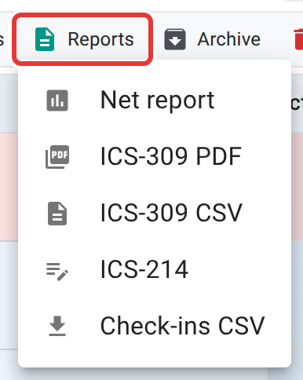

# Reports, ICS-309, and exports

A closed net's toolbar has one **Reports** button, which opens a menu of everything the net produced. None of it requires reopening the net or changes the record; pulling a copy again doesn't re-send anything. A net with **Build an ICS-205** on shows the **Reports** button before it closes too, to signed-in viewers, with **ICS-205 radio plan** as its only item.

<figure>
  
  <figcaption>Net report and ICS-214 open a page of their own; the rest download a single file.</figcaption>
</figure>

- **Net report** opens the full **Net Report** page, described below.
- **ICS-309 PDF** downloads the ICS-309 Communications Log as a form-accurate, printable PDF.
- **ICS-309 CSV** downloads the same log as a spreadsheet. The ICS-309 is a log of radio traffic, so a station checked in [In person](/docs/net-control/logging-check-ins/#checking-someone-in-in-person) isn't listed on it.
- **ICS-214**, for net control and the net's managers only, opens the net's Activity Log to finish and download. See [The ICS-214 activity log](/docs/net-control/ics-214/).
- **ICS-205 radio plan**, for signed-in viewers on a net with **Build an ICS-205** on, opens the net's radio plan. See [The ICS-205 radio plan](#the-ics-205-radio-plan) below.
- **Check-ins CSV** downloads the raw check-in list: every built-in field, the frequency each station checked in on, and each of the net's own fields that somebody filled in, one row per check-in event (including rechecks), in the timezone your own profile prefers. Like the ICS-309 and the net report, anyone can download it; a visitor who isn't signed in gets the same copy with email addresses and phone numbers in free-text fields hidden.

ICS-309 export is available on any closed net regardless of whether that net turned on the **Enable ICS-309 Communications Log format** toggle. That toggle, with the **ICS-309 log** switch on the net's **Reports** tab, decides whether the automatic closing email uses ICS-309 formatting for everyone (see [What the closing email contains](#what-the-closing-email-contains)). Anyone who turned on **Use ICS-309 format** in their own profile gets the closing email as an ICS-309 either way, so turning the net's toggle off doesn't stop it reaching them. The menu's ICS-309 downloads work either way.

### Keeping spam out of the record you hand to a served agency

The ICS-309 log is the copy that leaves your group and reaches a served agency, so it needs to stay clean even when a check-in doesn't. Under **ARES & EmComm Features** when creating or editing a net, **Hide muted stations from ICS-309** is on by default: once net control net-mutes a station for spam or disruption, that station's chat messages are left out of every ICS-309 output — the CSV, the PDF, and the automatic closing email — without deleting anything from the net's own chat log. Nothing else about the net record changes: the station's check-in still appears, and the plain check-in export and net-log email are unaffected. Muting a station is done from the chat panel; see [Net control](/docs/net-control/) for how.

## The net report page

<figure>
  
  <figcaption>The report page needs no sign-in. Export PNG saves a summary image and the map, ready to post.</figcaption>
</figure>

This page puts everything about the net into one document, in this order: check-in statistics and a map, who was at each site (if the net has [sites](/docs/net-managers/sites/)) and station-to-station coverage (if the net used it), the check-in log (one row per station per place, with every [field](/docs/reference/check-in-fields/#in-reports-and-exports) the net used), the schedule's announcements and the net's notes, the topic of the week and poll results, chat, the ICS-309 log, and last, the activity log. **Export PDF** saves it as one file. The **Export PDF** button on a net's statistics page produces this same report.

The page follows the switches on the net's **Reports** tab (see [Creating a net](/docs/net-managers/creating-a-net/#reports)): turn off a section there, such as the headline figures or chat, and the page leaves it out too. A net whose switches were never changed shows every section. The graphs, the map, the check-in log, and the activity log aren't on the Reports tab and always show.

### Choosing sections when you export

**Export PDF** and **Export PNG** first open **Choose sections**, a list of the sections this net's report has, ticked to match what the page shows. Untick what you don't want in the file, or tick a section the page is hiding, then click **Export PDF** or **Export PNG**. The choice is for that one file: it isn't saved, and the page looks the same afterward. The check-in log is always included. For the images, the list is the parts the images carry: the headline figures, the graphs, the check-in list, and the map.

In the check-in log, a station that checked in more than once at a place has one row, whose time reads how many check-ins it made and when the last one was. Its **Channels** column lists each channel the station checked in on, with the ones it only listed as reachable in brackets and any marked offline struck through. The ICS-309 and the CSV export still list every check-in.

On screen, the report follows your light or dark setting like the rest of the app. The PDF is always in print colors on US Letter pages, and it comes out the same whether you export it from a phone or a computer.

The top of the first page shows the net's logo, the net's name as the title, and the date and time it ran. ECTLogger is credited in a single line at the end. The report names the net's NCS as the ICS-309 and closing email do: whoever is credited for running it, or **Not recorded** (see [Who ran this net?](/docs/net-control/closing-the-net/#who-ran-this-net)). Every page of the PDF also carries the net's name, the date, and "Page 2 of 3" along the bottom, so a page separated from the rest of a printed copy still says what it belongs to.

The report's headings, numbers, and graphs take their color from the logo. The color is matched to the nearest of a short list of standard colors (navy, blue, teal, green, red, maroon, purple, and a few others) that are all easy to read on a white page. In dark mode the same color is shown a little lighter on screen so it stays readable, and the PDF uses the original. A logo that is mostly grey, black and white, brown, or yellow, and a net with no logo at all, gets a standard blue. There is nothing to set: upload a logo on the net or its schedule (see [Creating a net](/docs/net-managers/creating-a-net/)) and the report follows it.

### Images for social media

**Export PNG** saves the net as images sized for a Facebook, Instagram, or X post, or a newsletter, rather than one long page:

- **A summary image**: the net's logo, name, and date across the top, then the check-in count, operators, re-checks, and duration, the graphs, and a two-column list of every station with its name and town.
- **The map**, with the same header, if any stations gave a location.

No image is taller than a 4:5 portrait, the tallest shape Facebook and Instagram show without cropping in a feed. When a net has more stations than fit, the list carries on to a second image (and a third, if needed), marked "2 of 2" and repeating the header so each image makes sense on its own. A graph with only one category, such as a pie in which every station is "Checked In", is left out of the images because it says nothing in a post; the full report and PDF still show it. Each image carries a small footer crediting ECTLogger with the site's address. The **Export PNG** button on a net's statistics page produces these same images.

This page needs no sign-in to view — callsign and licensee information are already public via the FCC's own license database, and free-text fields are redacted for a signed-out viewer the same way the check-in list and chat already are. That makes the link safe to hand to anyone who needs the record, with or without an ECTLogger account. A net that's still running can be shared the same way; see [Sharing a net with someone who has no account](/docs/operators/finding-a-net/#sharing-a-net-with-someone-who-has-no-account).

## The ICS-205 radio plan

The ICS-205 Incident Radio Communications Plan is the Incident Command System (ICS) form that tells everyone on an incident which channel to use for what. ECTLogger builds it from the net's **Communication Plan** tab once **Build an ICS-205** is on there (see [Creating a net](/docs/net-managers/creating-a-net/#build-an-ics-205)). A plan is handed out before the net, so it's in the **Reports** menu whatever the net's status, for anyone signed in. A visitor who isn't signed in doesn't get it, since its assignments and instructions can name people and places.

The page shows the form's blocks, following FEMA's ICS 205 (version 3.1):

- **1. Incident name** is the net's name.
- **2. Date/time prepared** is when you download the PDF.
- **3. Operational period** runs from the net's scheduled start (or the time it started) to the time it closed, which is blank until then.
- **4. Basic radio channel use** has a row per channel, in the plan's order: a blank Zone Grp to write your radios' zone in, the channel number (the line number on the plan), its function, its name (the frequency's description, or its network and talkgroup), its assignment, the receive and transmit frequencies with N or W, the receive and transmit tones, the mode (A for analog, D for digital), and the remarks, which start with the channel's role. The receive frequency is the one on the frequency list, and the transmit frequency adds the repeater's offset.
- **5. Special instructions** comes from the Communication Plan tab.
- **6. Prepared by** names the net's NCS, with a blank signature line. When the net has more than one, it's the first NCS, the one assigned longest ago. Before anyone is NCS, the name is left blank to fill in by hand.

Nothing is edited on this page; **Edit the plan** opens the net's form for whoever can edit the net. **Download PDF** saves the form on US Letter pages in landscape, in print colors. When the channel table runs past one page, each later page repeats blocks 1 to 3, the table's headings, and block 6. Each page's footer reads "ICS 205" with a blank IAP Page for the planning section to number. A net with a [drill plan](/docs/net-managers/drill-plans/) is marked THIS IS AN EXERCISE at the top and bottom of every page.

## Who automatically gets the closing log by email

When a net closes, ECTLogger emails the log to:

- the net's **manager**, if their own notification preferences have net-close emails on;
- anyone explicitly **subscribed** to the schedule the net came from, with the same preference on;
- and every **active NCS, Logger, or Relay on that net itself**, again subject to their own preference — so staff who ran the net get a copy even if they never separately subscribed to the schedule.

Each recipient gets ICS-309 formatting if either the net sends it or that recipient's own profile prefers it.

### What the closing email contains

Every closing email has the net summary and the check-in log, with the check-ins attached as a spreadsheet. The rest is set on the net's **Reports** tab, or on its schedule's, for every net the schedule creates (see [Creating a net](/docs/net-managers/creating-a-net/#reports)): the headline figures under the title, the topic of the week with each station's answer, poll results, sites and station coverage, traffic counts, the schedule's announcements and the net's notes, a link to the full report at the end, and the chat log as an attached text file. A section tied to a feature is sent only while that feature is on.

With the **ICS-309 log** switch on, the email carries the ICS-309 Communications Log in place of the check-in table, with the ICS-309 spreadsheet attached. A net or schedule whose switches were never changed sends the email it always has: the topic, poll, coverage, traffic, and chat sections for the regular log, and the ICS-309 when **Enable ICS-309 Communications Log format** is on.

## Related

The export used to hand a net's radiograms and RRI/weather strips to a receiving station is covered in the traffic pages under [Net control](/docs/net-control/). Bringing a net's history in from outside ECTLogger, rather than exporting one out, is [Importing check-ins](/docs/net-managers/importing-check-ins/).
