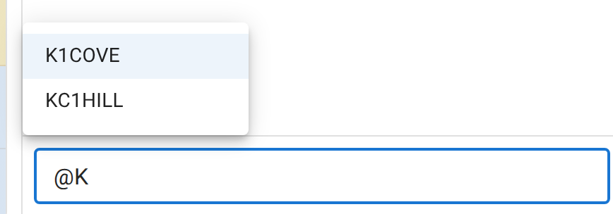
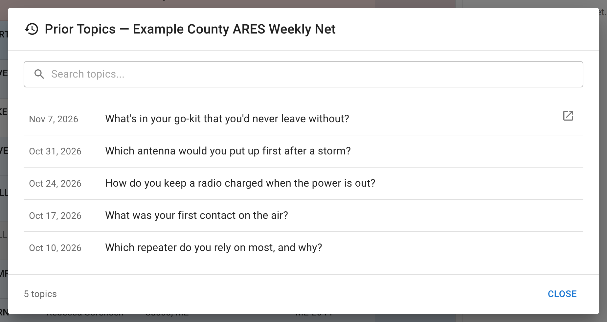

# Chat, polls, and topics

Every net has a text chat alongside it. It's a second channel, not a transcript of the net, and suits a side comment, a link, a question you don't want to key up to ask, or following along if you're listening.

You need to be [signed in](/docs/operators/signing-in/) to send a message. Signed-out visitors can still read chat on a net they're viewing.

## Sending a message

Type into the box at the bottom and press Enter. You can:

- **@mention** a station by typing `@` and picking from the list that pops up. The list offers only stations checked into this net who have an account and have the app open. You can still type a callsign out by hand if the operator you want isn't in the list. The mention is resolved against everyone checked into the net, so it will be waiting for them when they next open the message.
- **Paste an image** (PNG, JPEG, or WEBP) directly into the composer.
- **Reply** to a specific message by hovering it and clicking the reply icon. Your reply carries a small quote of the original above your text, Signal-style. Clicking the quote jumps back to the original message.

<figure>
  
  <figcaption>Typing the first letter or two narrows the list to matching stations.</figcaption>
</figure>

## Reacting to a message

Hovering over someone else's message shows a small row of emoji reactions. Click one to add it; the count appears under the message, and clicking a reaction you've already added removes it. You can't react to your own messages, so the reaction row appears only on someone else's.

## Editing and muting

Hovering your own message shows an edit pencil (text messages only; an uploaded image can't be rewritten). Editing replaces the message in place and marks it "(edited)"; there's no version history.

Hovering anyone else's message shows a mute icon: **mute this station**, for you only. It hides that callsign's messages in your own view of this one net. Nobody else is affected, and it doesn't touch the net's actual log or export. A banner above the chat shows how many stations you (or, on a net with staff-applied mutes, anyone) have muted, with a manage list to undo it. If Net Control has muted someone for the whole net (a moderation action, not something a participant can do), you won't be told who did it, only that the station is muted. When several different people mute the same station, the instance's admins are told how many, never who.

## Topic of the Week and the poll

If a net has a **Topic of the Week** or a **poll** running, you don't answer it in chat. You answer it in the [check-in form](/docs/operators/checking-in/), which shows the live question as context above a text field for your response. To change your answer later, click **Edit check-in** on the toolbar. Results (a tally for a poll, a list of responses for a topic) are shown as a summary once the net closes.

Topics and polls are separate from chat; they're covered here because the same kind of net (a community or club net rather than a formal traffic net) uses both.

### Prior topics

A net from a schedule keeps a history of its topics. Once the net has check-ins, **Topics** on the net toolbar opens **Prior Topics**: every topic the schedule has used, newest first, with the date on the left and a search box to find an old one. A topic asked on a net in ECTLogger links to that net, which opens in a new tab.

A topic goes into the history as soon as net control sets it, not only when the net closes. The net manager and the NCS can also edit or delete an entry, and **Add Historical Topic** records one from before the club used ECTLogger. An entry added for a date that's still ahead becomes the topic of that date's net. On the net's Edit page, the topic field offers the prior topics as suggestions, to show whether a question has been asked before.

<figure>
  
  <figcaption>Prior topics, newest first. A topic asked on a net in ECTLogger links back to it.</figcaption>
</figure>

## Chat after the net closes

Chat goes read-only when the net closes. A net manager can keep it open a little longer, for conversations that carry on after the last station is logged: **Keep chat open after closing** on the net or schedule's settings, for 15, 30, or 60 minutes. While that window is open you can still send messages, and they're part of the net's chat like any other. When it ends, the box goes read-only.

## Activity, separately from chat

Chat itself never shows check-in, check-out, or other system events. Those post to a separate **Activity Log** panel next to chat, not into the conversation. To follow who's coming and going, open that panel. There's no way to turn chat off entirely for a net you're viewing; to filter what you see there, mute individual stations (above).
