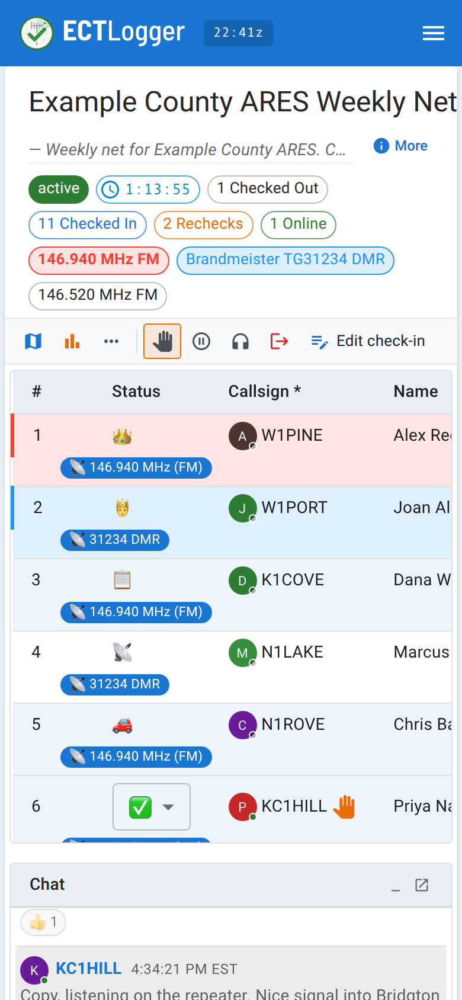

# On a phone in the field

ECTLogger is a website, not an installable app. There's no offline mode and nothing to download ahead of time, so do the setup below *before* you lose signal.

## Before you leave the house

1. **Sign in once, on the device you're taking.** A magic link keeps you signed in for a while afterward, so you shouldn't need a new one from a spotty inbox in the field.
2. **Set a password as a backup**, from [Profile > Security](/docs/operators/signing-in/). If you do get signed out at a bad moment and email delivery is slow or your inbox is hard to reach from where you are, a password gets you back in without an email.
3. **Turn on location awareness first, if you want it**, from Profile > Settings. It needs your browser to grant a GPS permission prompt, and that prompt needs connectivity to appear and to be answered — asking for the first time in the field, with no signal, won't work. See [Your location and the map](/docs/operators/location-and-the-map/).
4. **Know which net you're checking into** and get to its page once, while you still have a connection, so it's in your browser history or bookmarked.

## What's different on a small screen

The check-in list simplifies on a phone: other stations' rows are read-only (so an accidental tap while you're scrolling one-handed changes nothing), and the only per-row actions offered are staff-only: deleting a check-in, and on a net that logs coverage, recording what a station can hear. Your own status is still one tap away through the status dropdown, as described in [Status, rechecks, and checking out](/docs/operators/status-and-checking-out/); it isn't staff-only, because it's your row. **Step away**, **Just listening**, **Check out**, and **Edit check-in** (to fix anything you missed on your row) are quicker from the toolbar. On a phone the toolbar shrinks those buttons to icons, then tucks them into the **More** menu at its end; they work the same there. Chat, the map, and the check-in form itself all work as on a desktop, laid out for a narrower screen.

<figure>
  
  <figcaption>Other stations' rows are read-only on a phone; your own status is still yours to change.</figcaption>
</figure>

## Logging what you did off the net

If you check in to another net, call on a statewide talkgroup, or send a Winlink message while you're out, log it with the **Off-net** button on the net toolbar, which is there on nets that keep an ICS-309, (on a narrow phone it may be in the **More** menu, the three dots). It goes on this net's ICS-309 once net control accepts it. Log that it happened and fill in the Winlink message ID, but not the message itself. If you can't reach the app, tell net control over the air and they'll log it for you. See [Logging off-net activity](/docs/net-control/off-net-log/).

## What degrades on a bad connection

A weak or intermittent signal doesn't break the app outright, but a few things get rougher:

- **The live connection can drop and go stale without warning.** ECTLogger watches for this and reconnects after a couple of missed heartbeats, but for a few seconds you may look offline to everyone else, or their updates may lag behind what you see.
- **Pasted images in chat may fail to upload** on a very slow link, even when plain text messages go through.
- **GPS accuracy varies** with how good a fix your phone can get, as with any GPS use; a weak fix gives a less precise grid square.

## When your phone can't reach the server at all

**Check in over the air, like a station with no browser.** Give your callsign and information to Net Control or the Logger by voice, and they'll log it from their end. Your check-in lands in the same list, on the same map, in the same report as everyone who typed it in themselves. Being offline costs you nothing in the net's record; the app is a log of the net, not a requirement for taking part.

When you're back in range, open the net again and confirm your check-in is there. If your status changed in the meantime (you moved, you're wrapping up), update it yourself once you're connected; see [Status, rechecks, and checking out](/docs/operators/status-and-checking-out/).
