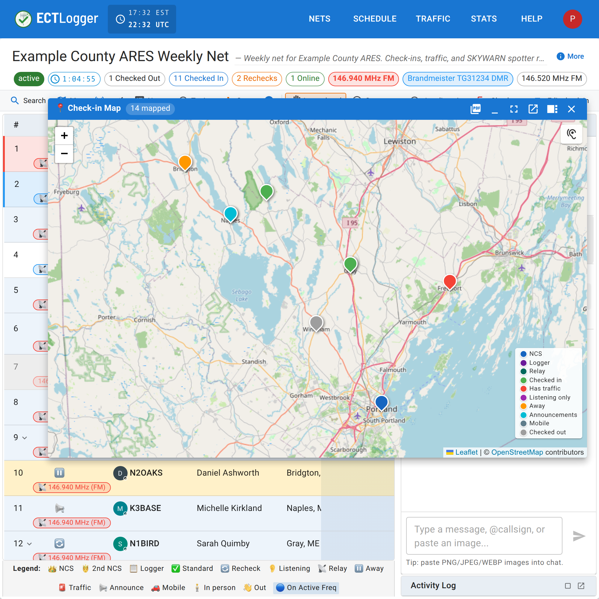

# Your location and the map

The Location field on a check-in is free text, but ECTLogger tries to understand it well enough to put a pin on a map. The map is only as good as what is typed into that field.

## What the Location field understands

Type any of these into Location (at check-in, or as your [default location](/docs/operators/account-and-profile/)) and the map can generally place it:

- **A place name** — "Portland, ME," a town, a landmark. This gets geocoded against an address lookup service, which takes a moment, and the place has to resolve to somewhere real; a vague or made-up place won't plot.
- **GPS coordinates** — decimal degrees (`43.6591, -70.2568`) or degrees/minutes/seconds (`43°39'33"N 70°15'24"W`).
- **Maidenhead grid square** — the format amateur radio already uses for propagation reporting (`FN43pp`). Understood down to the sub-square if you give it one.
- **UTM** — Universal Transverse Mercator (`19T 348123 4834567`).
- **MGRS** — Military Grid Reference System, the format most ARES/served-agency partners already use on paper maps (`19TCH4812334567`).

Any of these works. Use whichever you or the people relying on your report already think in. A SKYWARN spotter typically has a grid square memorized, a served agency partner working from a paper map is probably giving you MGRS, and a phone's GPS app usually gives decimal coordinates. The map treats all of them the same once parsed. Full format details live in the [location formats reference](/docs/reference/location-formats/).

## Auto-filling it instead of typing it

Two settings, both in your [profile](/docs/operators/account-and-profile/), save you typing a location every time:

- **Default Location** fills in whatever you set until you change it or override it.
- **Location awareness** asks your browser for GPS permission and keeps a live Maidenhead grid square and the town it falls in, both shown in the navbar. Your check-in's Location fills in with the town (`Waterboro, ME`, or `Guildford, United Kingdom` outside the US, Canada, Australia and Mexico) instead of your static default, because net control can read a town aloud. Hover over that location in the check-in list, or tap it on a phone, to see the grid square behind it. The map still plots you from the grid square, which is more precise than the town. If the town can't be looked up, the grid square fills in instead. It only updates while the setting is on and your browser has granted permission. There's a **Clear GPS location** button in Settings to drop the stored value without turning location awareness off.

Whatever auto-fills is text in the field until you submit, so edit it if it's wrong.

## What the map shows

Every net with at least one parseable location on a check-in has a live map, and the same map data drives the net's report and its statistics page, so a station isn't plotted on one and missing from another. A few things that surprise people:

- **Checked-out stations are still plotted.** The map records who took part, not who is still on frequency, so someone who checked in, participated, and checked out an hour ago stays on the map.
- **There's no cap on how many stations get mapped.** Every check-in with a resolvable location is geocoded and plotted, even on a busy net.
- **Markers are colored by role and status** — NCS, Logger, Relay, and each station status get their own color, with a legend on the map itself. If a station's color looks off, check its role and status in the check-in list; the legend uses the same terms as [Status, rechecks, and checking out](/docs/operators/status-and-checking-out/).

<figure>
  
  <figcaption>Every checked-in station with a location ECTLogger can parse, including ones already checked out.</figcaption>
</figure>
