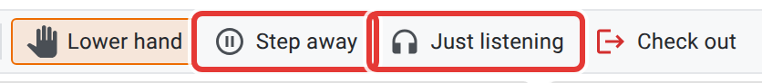
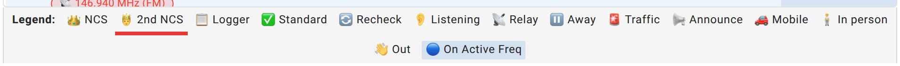
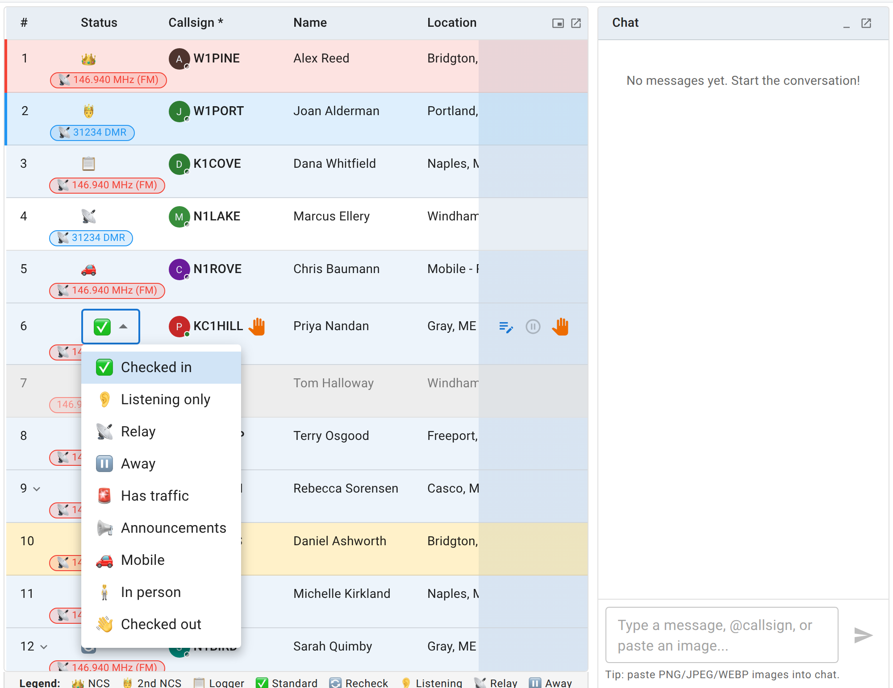

# Status, rechecks, and checking out

The check-in list has a legend across the top of the table. It looks like one flat row of icons, but it describes three different kinds of thing, and most of the confusion about "statuses" comes from not separating them:

1. **Station statuses** — what you're doing, set from the dropdown on your own row. (The rest of your row you fix with its pencil; see [Fixing your check-in](/docs/operators/checking-in/#fixing-your-check-in).)
2. **Role badges** — a standing job on the net (NCS, Logger), which replaces your status icon while you're in the default checked-in state.
3. **The recheck marker** — a one-time flag on a specific check-in row, not a status at all.

This page is about the first and third. Roles belong to whoever is running the net; see the [net control](/docs/net-control/) path if that's you.

## The nine statuses

| Icon shown | Label | Tooltip | Set it when |
|---|---|---|---|
| check mark | Checked in | Checked in and available | The default. You're there and reachable. |
| ear | Listening only | Monitoring only, not transmitting | You're following along but not planning to key up. |
| antenna | Relay | Relay station - can relay stations NCS cannot hear | You're passing traffic for a station NCS can't hear directly. |
| pause | Away | Temporarily away, will return | Stepping away briefly — see below, there's a dedicated button for this. |
| siren | Has traffic | Has traffic or emergency to report | You have something for NCS, formal or not. |
| megaphone | Announcements | Has announcements to share | You have something to say to the net. |
| car | Mobile | Mobile - may only be available briefly | You're operating from a vehicle and might drop off suddenly. |
| standing figure | In person | In person, not on the radio - don't call on the air | You're at the site in person (the EOC, a shelter) without a radio. Usually net control sets this for you when you sign in at the door. |
| waving hand | Checked out | Checked out of net | You're done for this net. |

That's the complete list: nine statuses and no others. If you've seen an older guide mention a status called "Available," that was never a real one. Every status above except "Checked in" and "Checked out" is one you choose because it's true of you.

You can change your own status at any time while you're checked in, straight from the check-in list, with no NCS or Logger involved. The dropdown there is the only place all nine are offered.

The net's toolbar, across the top of the page, has buttons for the ones you'll want mid-net:

- **Step away** (a pause icon) puts you in Away, for a bathroom break or a quick errand without checking all the way out. While you're away the same button reads **Return**, and clicking it puts you back to Checked in.
- **Just listening** (a headphones icon) puts you in Listening only, for when you're monitoring rather than transmitting. It toggles back the same way.
- **Check out** (a red exit icon) sets Checked out, as the dropdown does.
- **Raise hand** (a hand icon, and not a status at all) flags that you want to say something without changing your status. It suits a net where interrupting isn't the norm. It reads **Lower hand** once your hand is up, and it isn't offered to the acting NCS, who runs the queue rather than joining it.

<figure>
  
  <figcaption>The two statuses you use most mid-net have their own buttons.</figcaption>
</figure>

On a narrow screen those buttons drop their labels to save room, and then move into the **More** menu at the end of the toolbar if there still isn't space. They do the same thing from there.

The other four statuses (Relay, Has traffic, Announcements, and Mobile) have no button of their own. The dropdown on your row is where you set those.

## The role badges you'll see but can't set

Two icons in the legend describe a role, not a status, and they only ever show up on someone else's row (or your own, if you hold the role):

- **NCS** (a crown icon) — Net Control Station, currently running the net.
- **2nd NCS** (a crown-and-scepter icon) — it is **not** a separate role you can be assigned. Some nets legitimately run with more than one active NCS at once. A multi-desk SKYWARN activation is the clearest example, where several people each run their own frequency as NCS at the same time. The list marks every NCS after the first-assigned one with this second icon instead of a second crown, so it shows which NCS was there first. You won't find "2nd NCS" in a list of roles you can be given.
- **Logger** (a clipboard icon) — assists NCS with logging. Also a role, also not something you set via a status dropdown.

These badges only appear while a station is in the plain Checked in state. If an NCS or Logger sets a status, say they go Mobile or step Away, that status icon takes over from the badge for as long as it applies.

## The recheck marker isn't a status either

If you check in, then later check in again under the same callsign, ECTLogger doesn't update your existing row. It adds a new row, timestamped when the recheck happened, and links it back to your first check-in. NCS wants to know *when* a station rechecked, on what frequency, and how many times.

One recheck does change your earlier row. On a net with sites, checking in from a different site than your current check-in (a different shelter, Home, or Traveling) checks your earlier check-in out, because you can't be in two places at once. A recheck from the same place on another frequency leaves both rows checked in.

The check-in list keeps one row for you at each place you check in from, showing your newest check-in there with the recheck (circular arrows) icon instead of the usual check mark. That's what you're seeing when the legend shows a "Recheck" entry: a flag on your row, not a tenth status. On a net with more than one frequency, the row has a chip for each channel you've checked in on there. A small arrow beside the row's number opens its timeline, with each of your check-ins and its time. Nothing is merged away: every recheck is still in the net's log.

<figure>
  
  <figcaption>The legend mixes roles (NCS, 2nd NCS, Logger), statuses, and the recheck marker in one row.</figcaption>
</figure>

## Checking out

Setting your status to **Checked out** tells NCS you're done, and keeps the net's log accurate: participation counts, the [ICS-309](/docs/reference/emails/) form if the net generates one, and your own [statistics](/docs/operators/your-statistics/) all read off the check-in list as it stood when the net closed. A station that's gone but still shows Checked in makes the net look busier than it is and can leave NCS waiting on someone who left an hour ago.

You don't have to check out before a net closes, since closing the net doesn't erase anyone's status. If you know you're leaving, checking out tells whoever is running the net who is still there.

<figure>
  
  <figcaption>Every status is in the dropdown on your own row.</figcaption>
</figure>
