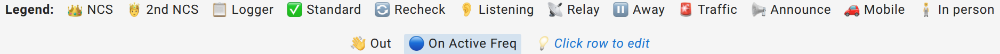

# Station statuses

A station's status is the icon and word shown in the Status column of the check-in list. It is set when a station checks in, and can be changed at any time (by the station itself, or by NCS/Logger) while the net is active.

There are nine statuses.

| Icon shown | In the legend | In the dropdown | Means on the air | Plotted on the map | Also affects |
|---|---|---|---|---|---|
| A green checkmark | Standard | Checked in | Checked in and available | Yes | Default status; also the icon shown for a role holder (NCS, Logger, Relay) who has no other status set |
| An ear | Listening | Listening only | Monitoring only, not transmitting | Yes | — |
| A satellite dish | Relay | Relay | Can relay stations NCS cannot hear | Yes | Also a per-net role (see [Roles and permissions](/docs/reference/roles-and-permissions/)); the role badge takes priority over this status when both apply |
| A pause symbol | Away | Away | Temporarily away, will return | Yes | — |
| A siren | Traffic | Has traffic | Has traffic or an emergency to report | Yes | Shows the traffic icon in the toolbar for NCS/Logger if traffic handling (see [Glossary](/docs/reference/glossary/)) is enabled on the net |
| A megaphone | Announce | Announcements | Has announcements to share | Yes | — |
| A car | Mobile | Mobile | Mobile station, may only be available briefly | Yes | Sorted above chronological order unless the net's manager has turned mobile-priority sort off. It is on by default |
| A standing figure | In person | In person | Here in person, not on the radio, so don't call them on the air | Yes | The row is tinted and has no frequency. See [Checking someone in in person](/docs/net-control/logging-check-ins/#checking-someone-in-in-person) |
| A waving hand | Out | Checked out | Checked out of net | **Yes** | Excluded from the "currently on frequency" count, but not from the map or the log |

There are two columns because ECTLogger uses two sets of words for the same nine statuses. The legend under the check-in list is short to fit on one line ("Standard", "Traffic", "Out"); the status dropdown and the net report spell them out ("Checked in", "Has traffic", "Checked out").

A CSV export writes a third form, the internal names: `checked_in`, `listening`, `relay`, `away`, `has_traffic`, `announcements`, `mobile`, `in_person`, and `checked_out`.

## Checked-out stations are still plotted

**Checking out does not remove a station from the map.** The map, the net report, and the statistics page record who took part in the net, not who is still on frequency. A station that checked in, held traffic, and checked out twenty minutes before the net closed is still a participant, and every map in the app plots it.

If a station is missing from the map, the reason is almost always that its Location field could not be parsed or geocoded, not that it checked out. See [Location formats](/docs/reference/location-formats/) for what the map can and cannot read.

## Recheck is not a status

A recheck is what happens when a callsign that is already checked into the net checks in again. There is no `recheck` value in the list above because it isn't a station's status, it's a description of what just happened. It is a new check-in, not an update to the existing one: the log, the CSV export, and the ICS-309 each list the original check-in and the recheck with its own timestamp.

The check-in list shows one row per station per place, the station's newest check-in there, carrying the Recheck marker in place of its normal Standard checkmark. The row's timeline, opened from the arrow beside its number, lists every check-in behind it. A station that checks in from a different place gets a row of its own there. See [Rechecks](/docs/net-control/logging-check-ins/#rechecks).

Checking out is one exception to rows being independent: setting any row for a callsign to Out sets every other row for that same callsign in the net to Out as well, original check-in and every recheck together.

A recheck from a different site is the other: on a net with [sites](/docs/net-managers/sites/), checking a station in at a different site, Home, or Traveling than its live check-in sets that earlier check-in to Out, since a station can't be in two places at once. A recheck from the same place on a different frequency leaves both rows as they are. See [Stations at sites](/docs/net-control/stations-at-sites/#when-a-station-moves).

"Recheck" is a marker on one row, not a tenth entry in the status list above.

## The legend mixes three different things

The check-in list has a Legend bar above the table, and it lists more than statuses. It combines three kinds of information in one row:

- **Per-net roles**: NCS, 2nd NCS, and Logger. These are not statuses at all; they describe who is running the net, not what a station is currently doing. See [Roles and permissions](/docs/reference/roles-and-permissions/).
- **Station statuses**: Standard, Listening, Relay, Away, Traffic, Announce, Mobile, In person, and Out, the nine values in the table above (Relay appears as both a role and a status, since a station can hold the Relay net role or report itself as relaying).
- **The Recheck marker**, which is neither a role nor a status, as explained above.

If something on the legend doesn't fit the status table on this page, it's a role or the recheck marker.

<figure>
  
  <figcaption>The legend above the check-in list. It combines net roles, station statuses, and the Recheck marker in one row.</figcaption>
</figure>

## "2nd NCS" is real, but it isn't a role you assign

"2nd NCS" appears in the legend with the tooltip "2nd NCS - assists primary Net Control Station." It is how the check-in list marks any additional active NCS beyond the first one assigned. There is no separate assignable role called "2nd NCS"; every NCS holds the same role. The list shows the first-assigned active NCS with a crown and every other simultaneously active NCS with a second, smaller crown, for as long as the first one is still checked in.

Multiple simultaneously active NCS is normal (a multi-desk exercise with several stations each running their own frequency, for example); see [Roles and permissions](/docs/reference/roles-and-permissions/) for who can become NCS and when.

## Custom fields don't add statuses

An admin can add custom check-in fields (see [Check-in fields](/docs/reference/check-in-fields/)), but a custom field is data on a check-in, never a new entry in the Status dropdown. The nine statuses above are fixed.
